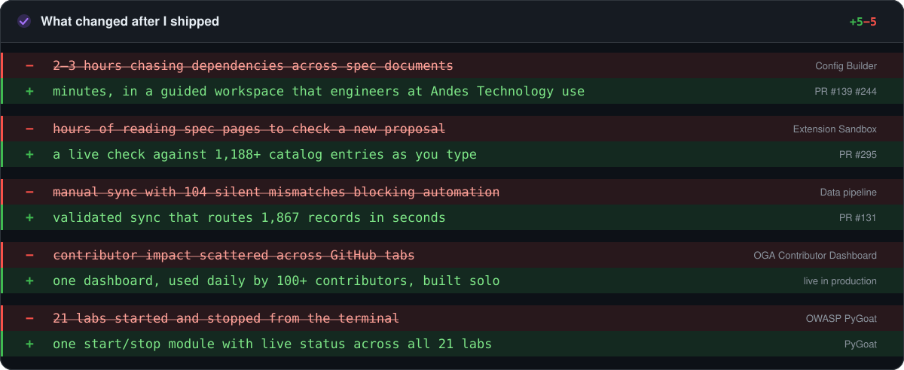
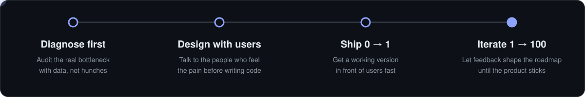

  

  
  
  

> **I don't wait for tickets.** I find what slows real users down, design the fix with them, build it from 0 to 1, then keep improving it from their feedback until it's a 1 to 100 product.

I'm a full-stack engineer (B.Tech CSE, 2028) who works backwards from the user's problem to production: backends I'd trust with real data, and frontends that make hard work feel fast. I learn unfamiliar domains quickly, I take ownership without being asked, and I ship, then listen, then ship again.

**What you get on a small, fast team:** product thinking, end-to-end ownership, quick iteration on user feedback, and code that is validated, tested and reviewed before it merges.

 

## What changed after I shipped

  

 

## Selected work

### OGA Contributor Dashboard, built solo for OpenGov Africa
*Founder and lead developer · React, PostgreSQL, GitHub API, Zod, Vitest · [Live](https://oga-dashboard-beta.vercel.app) · [Repo](https://github.com/OpenGovAfrica/oga-contributor-dashboard) · [Walkthrough](https://vimeo.com/1216654213)*

Non-engineering teams couldn't see contributor impact beyond scattered GitHub tabs. I proposed a platform, then designed, built, tested and deployed it alone across 30+ repositories. It's used daily by 100+ contributors and the team leads, and it keeps improving from their feedback.

- **Dashboards for non-engineers:** time-windowed KPIs, PR cycle-time bottleneck detection, streak and retention tracking, and a Code vs. Civic leaderboard so non-code work gets the same visibility.
- **Production-minded backend:** idempotent, resumable GitHub sync with rate-limit-aware batching and saved execution state.
- **AI layer:** maintainers ask who needs help and where to focus this week, and get an answer in seconds instead of hours of manual review.
- **Quality:** 113 assertions across 6 Vitest files with boundary cases and fake timers, and no production code changed to make them pass.

I'm also a Maintainer and Operations Team Lead at OpenGov Africa.

 

### RISC-V ISA Explorer, core contributor through the Linux Foundation mentorship
*LFX Mentee, Jun to Sep 2026 · mentor: Rafael Sene · Node.js, JavaScript, JSON data infrastructure, frontend UI · [Live app](https://riscv.github.io/riscv-isa-explorer) · [Repo](https://github.com/riscv/riscv-isa-explorer)*

The Explorer is the web app engineers use to understand RISC-V, the open standard that processor companies build on. I was one of three mentees worldwide. I worked inside an existing codebase with maintainers, finished my assigned scope, then picked up problems nobody had assigned me. The features below are used by engineers at Andes Technology and other teams, and RISC-V International published my write-up, [*The Problems Nobody Assigned Me*](https://riscv.org/blog/my-risc-v-mentorship-the-problems-nobody-assigned-me/).

| What I shipped | The problem | The result |
|:--|:--|:--|
| **Config Builder** PR #139, #244 | Engineers assembling a configuration chased hidden dependencies and silent conflicts across long specification documents, 2 to 3 hours each. | Dependency resolution, conflict detection, live config output and an export traced to primary sources. The task now takes minutes. After engineers said the side panel felt cramped, I rebuilt it as a full-screen workspace with saved progress. |
| **Extension Sandbox and Proposal Studio** PR #295 | Clashes had already slipped into official specifications, and there was no fast way to check a new proposal before spending engineering time. | Live check against 1,188+ catalog entries, a visual editor, a safe zone for private designs, and an export with a record of every check. |
| **Data pipeline rewrite** PR #131 | The sync was manual. An audit I ran across 220 entries found 104 silent mismatches blocking automation. | A 3-pass routing engine that validates every run and replaces the catalog atomically only when every check passes: 1,867 records across 83 groups, in seconds. |
| **Interface overhaul** PR #140, #164, #168 | Dense data that was hard to scan. | A dark, information-dense "command center" with global search, live counts and color encoding, then polish for light-theme contrast, mobile responsiveness and accessibility. No change to core data logic. |

 

### OWASP, full-stack contributions
*PyGoat, Juice Shop, Cheat Sheet Series · 16+ pull requests merged or approved · 2024 to present*

- **PyGoat (Python/Django):** a start/stop, live-status and concurrency-control module across all 21 lab templates, which closed a mentor-filed issue. Plus an Nginx reverse proxy with Docker Compose profiles that became the base of the project's lab-lifecycle system.
- **Juice Shop (Angular frontend):** five frontend and accessibility PRs merged directly by the project's creator.
- **Cheat Sheet Series:** wrote the JSON Web Encryption cheat sheet with Jim Manico as mentor.

 

### Also
- **Full-stack web developer intern, CodSoft (Oct to Nov 2025):** a job board and a quiz platform in React, TypeScript, Tailwind and Supabase/PostgreSQL, with JWT/OAuth 2.0, role-based access control, row-level security and 18+ reusable UI components, in Agile sprints.
- **Freelance web development:** client-ready sites and small tools for international small businesses, which keeps me close to what non-technical customers actually need.

 

## How I work

  

- **Trust is a feature.** Validate before every write, replace data atomically, trace outputs to their sources and keep a record of every check.
- **Make experts fast and everyone else able.** Dashboards that show people where to look first, and interfaces that turn hours of specialist work into minutes.
- **AI is a tool, not a shortcut.** I use AI assistance heavily and review and test every change myself before it merges.

 

## Stack

| | |
|:--|:--|
| **Frontend** |       |
| **Backend** |       |
| **Data** |    |
| **Quality and delivery** |       |

 

## Recognition

- **LFX Mentee, RISC-V International (Linux Foundation), 2026.** One of three mentees worldwide, with a letter of recommendation from my mentor.
- **Featured in RISC-V International's weekly newsletter** (25 Sep 2026) and **published on riscv.org.**
- **Hacktoberfest 2025 SuperContributor**, top 1,000 worldwide.
- **1st place, inter-university hackathon:** a full-stack event registration app built in under 3 hours. Finalist in three more.
- **University Project Topper**, ranked #1 in project assessment.
- **Oracle Cloud Infrastructure Certified Developer Professional** (2025).
- **City Lead, Jaipur, GirlScript Summer of Code** (2025 to Feb 2026), leading workshops and a student open source community.

 

## Let's build something

I'm looking for a full-stack or product engineering role on a fast-moving team, remote or on site, where I can own problems end to end. If you have an unsolved user problem, I'd love to hear about it.

  
  &nbsp;
  

